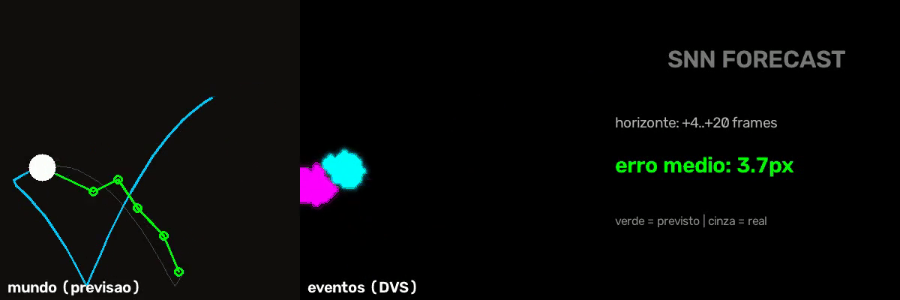
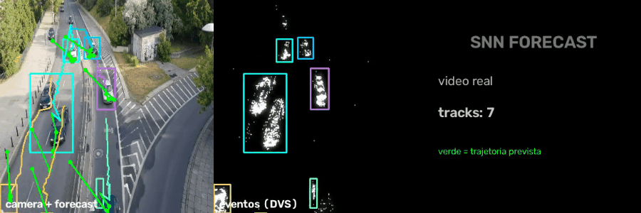

# SNN-Forecast

Previsão de trajetória com Spiking Neural Network: a rede vê **só o passado em eventos** e desenha **onde o objeto vai estar** nos próximos frames.



## Como funciona

```
simulador balístico -> frames -> eventos ON/OFF (DVS)
   -> 32 frames de histórico = 8 event frames
   -> encoder conv-LIF temporal -> membrana de leitura
   -> head regrediza 5 posições futuras (+4 a +20 frames)
```

- **Dados 100% sintéticos**: trajetórias balísticas com gravidade, quique e reflexão — dataset infinito, zero labels
- **SNN temporal**: cada event frame alimenta a rede por 2 timesteps — a dinâmica de movimento vive na membrana dos neurônios
- **Erro médio: ~5-7px** num grid 64×64 (≈10% do espaço) prevendo 20 frames à frente

## No vídeo

- Cyan: passado real | Cinza: futuro real | Verde: futuro **previsto pela SNN**
- A linha verde acompanha o arco — inclusive a curva do quique

## Vídeo real



Pipeline completo em footage real de tráfego (`src/demo_real.py`):
eventos DVS → detecção por clustering → **tracker com Kalman** extrai
trajetórias reais (auto-labeling, ~270 trajetórias de vídeos da web) →
**SeqForecastSNN** lê os últimos 16 centroides como *deltas* (velocidade)
e regrediza deslocamento acumulado — ~27px de erro médio prevendo
+4..+20 frames de cada carro em tempo real.

## Uso

```bash
pip install -r requirements.txt
python -m src.train --epochs 15     # gera dados e treina
python -m src.demo -o demo/forecast.mp4
```

## Por que isso importa

Previsão temporal é onde SNNs deveriam brilhar: a informação temporal já vive nos estados de membrana — a rede não precisa de janelas gigantes nem RNNs pesadas pra "lembrar" velocidade e direção.

Quinto projeto da série neuromórfica:
[snn-ocr](https://github.com/vsousadelvek/snn-ocr) ·
[snn-gesture](https://github.com/vsousadelvek/snn-gesture) ·
[snn-tracker](https://github.com/vsousadelvek/snn-tracker) ·
[snn-anomaly](https://github.com/vsousadelvek/snn-anomaly)
